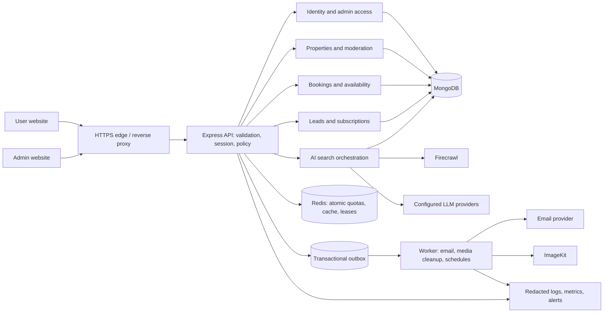

> Repository update — 4 November 2026: the accepted TypeScript admin now lives in `admin/`. The legacy JavaScript admin was removed by owner request and remains in Git history. Dated findings and phase branch names below are historical.

# BuildEstate project audit

> **Implementation update:** Phase 1 changes and verification are documented in [docs/phase1/PHASE_1.md](docs/phase1/PHASE_1.md). The findings below preserve the original audit snapshot; use the phase registers for current remediation status.
>
> **Phase 2 implementation:** Shared contracts, domain transactions, device sessions and verification are documented in [docs/phase2/PHASE_2.md](docs/phase2/PHASE_2.md). Deployment and legacy-data migration remain explicit rollout steps.

> **Active admin-rebuild plan:** [ADMIN_NEW_PLAN.md](ADMIN_NEW_PLAN.md) tracks the separate backend-readiness and `admin` work. Its Phase 3 acceptance gate passed locally on 3 November 2026; see [acceptance evidence](backend/docs/admin-phase3-acceptance.md) and [accepted API contracts](backend/docs/admin-api-contracts.md). These current records supersede fixed behavior in the original snapshot below; original finding/advisory totals are not a new scan.
>
> **Owner decision:** the original **Phase 4 — Make operations dependable** remains **deferred**. The new plan's Phase 4 means the replacement-admin foundation, not completion of operations work.

Audit date: **2 November 2026**. Scope: the local working tree of `backend/`, `admin/`, `frontend/`, `shared/`, application manifests/lockfiles, and checked-in deployment configuration. This is an audit and improvement plan; application behavior was not changed.

## 1. Overall assessment

**The project has useful functionality, but it is not ready to be treated as a secure, complete production system.** The main problems are authorization policies that are not enforced consistently, broken integration between working backend endpoints and frontend controls, data integrity gaps, and deployment checks that can report success while important checks fail.

The register contains **57 findings: 14 High, 38 Medium, and 5 Low**. These combine security, correctness, completeness, and operational issues; they are not 57 independently exploitable vulnerabilities. Dependency advisory counts are separate.

The right next step is to stabilize the existing application and formalize its contracts. A microservice rewrite would add complexity without fixing these defects.

Highest-priority confirmed problems:

1. Banned and suspended users still pass authentication and can continue using protected features.
2. Any authenticated user with a guest appointment ID can cancel that appointment.
3. Password reset/change does not revoke existing sessions.
4. Admin property updates use the wrong content type; a separate backend multipart path can erase all images on a text-only edit.
5. Public listings, admin listings, the review queue, and user listings silently omit records because pagination is not connected.
6. Signed-in users book through the guest endpoint and cannot see those appointments in their dashboard.
7. LLM circuit breakers can remain unavailable after a temporary failure because their recovery path is skipped.
8. The user listing edit route and newsletter unsubscribe page are missing.
9. Frontend TypeScript and admin lint fail despite successful production builds.
10. Locked dependencies have numerous advisory matches, including critical package entries; Multer has an independently confirmed maintainer advisory as well.

Existing strengths worth keeping: administrator authentication on mutation routes; ownership checks for user property changes; hashed password-reset, verification, and refresh tokens; short-lived access tokens; email verification; upload size/count limits; production CORS allowlists; Helmet; request IDs; model indexes; readiness endpoint; and separation of the user website, admin website, and API. These controls need tests and consistent integration, rather than removal.

## 2. Evidence, coverage, and limitations

### What was checked

- Backend route mounts and authorization, all eight controllers, the ten models, six middleware modules, service/provider code, utilities, migration scripts, and startup/deployment behavior.
- Admin routes, every page, session/API integration, add/edit/list workflows, review actions, user moderation, appointments, logs, and AI model controls.
- Frontend routes, authentication state, API requests, listing management, booking, property filters, AI streaming, newsletter/contact integration, and sitemap/SEO.
- Application source inventory: **228 files / 33,970 lines**, excluding dependency trees, build output, lockfiles, binary assets, and skill packages. The [source inventory](docs/audit/SOURCE_INVENTORY.md) describes review depth. Generated UI primitives received static import/type checks; this is not a claim of manual verification of every presentation line or every possible execution path.

### Verification results

| Check | Result | Meaning |
|---|---|---|
| Backend JavaScript syntax | 60 files, 0 failures | Parses successfully; does not establish runtime correctness |
| Backend `npm test` | Exits 0, prints `No tests specified` | There is no backend regression suite behind this command |
| Admin `npm run build` | Pass | Produces a 934.85 kB main JS chunk, 273.40 kB gzip |
| Admin `npm run lint` | **Fail: 38 errors, 5 warnings** | Includes unused code, JSX escaping, hook dependencies, and config globals |
| Frontend `npm run build` | Pass | Vite transpiles the reachable import graph |
| Frontend `tsc --noEmit` | **Fail: 30 errors** | Missing UI dependencies and a dependent type error |
| Isolated defect probes | **13 reproduced** | Stubs replace persistence/providers; no production requests |
| npm advisory scan | Backend 25; admin 27; frontend 16 affected package entries | Includes development dependencies; not 68 unique or proven exploitable defects |

Evidence:

- [Reproduction script](docs/audit/reproduce-findings.mjs) and [captured results](docs/audit/evidence/reproduction-results.txt).
- [Dependency details, versions, advisory links, and fix caveats](docs/audit/evidence/DEPENDENCIES.md), with original JSON snapshots beside it.
- [Backend syntax results](docs/audit/evidence/backend-syntax.txt).
- [Frontend type-check output](docs/audit/evidence/frontend-types.txt) and [admin lint diagnostics](docs/audit/evidence/admin-lint.json).

Dependencies were installed from existing lockfiles with lifecycle scripts disabled. The runtime checks import selected modules and stub database/provider methods; they do not start the server, call a database, send mail, scrape websites, or invoke AI providers. Run the probes from the repository root with `node docs/audit/reproduce-findings.mjs`. They assert **current defects**, so they should be replaced with tests asserting corrected behavior after fixes.

### What remains unverified

No live penetration test, browser accessibility audit, actual MongoDB transaction/concurrency test, email-delivery test, AI-provider compatibility test, container deployment, backup restore, or production cloud/account configuration inspection was performed. Credentials, real user records, and historical Git objects were not exhaustively scanned. No assertion is made that the code contains no other vulnerabilities. A perfect or vulnerability-free system cannot be certified by a source audit.

Severity: **High** = authorization, material integrity/availability, or major user workflow failure; **Medium** = important correctness, completeness, or hardening gap; **Low** = smaller operational/presentation/maintenance issue. Dependency severity is the advisory database's assessment, and is reported separately from application reachability.

Evidence labels: **Reproduced** = isolated probe; **Source-confirmed** = directly traceable code/contract defect; **Advisory** = matching package version; **Recommendation** = proposed capability or design, not an existing exploit.

## 3. Backend module-by-module audit

### 3.1 Identity, authentication, and sessions

Files: `backend/controller/userController.js`, `backend/middleware/authMiddleware.js`, `backend/models/userModel.js`, `backend/routes/userRoutes.js`, `backend/middleware/rateLimitMiddleware.js`.

**S01 — High — Moderation does not block account access. Reproduced.**

`authMiddleware.js:5–33` checks token validity and whether a user exists, but not `status`, suspension expiry, or verification status. `userController.js:76–150` and `:391–411` issue login/refresh sessions without rejecting banned or suspended users. Admin bans expire current active listings but do not prevent the user from submitting more listings, editing their profile, refreshing, or performing authenticated actions. Fix this through one account policy used by login, refresh, verification auto-login, and every protected request. Invalidate sessions on moderation. Acceptance: existing access/refresh credentials fail after a ban; a suspended account is rejected until its exact expiry.

**S03 — High — Password changes and reset leave old sessions usable. Source-confirmed.**

`userController.js:256–278` changes the password and clears the reset token but leaves `userRefreshTokenHash` intact. `:508–522` does the same for profile password changes. `protect` has no password-change timestamp/session version check. A previously stolen refresh token can continue creating sessions after recovery. Clear all refresh sessions and reject older access tokens with a session version or `passwordChangedAt` policy. Test logout, change, reset, and moderation revocation together.

**S04 — Medium — Admin authorization trusts an email claim without checking current administrator state. Reproduced.**

`authMiddleware.js:44–60` accepts a valid signed token whose email matches `ADMIN_EMAIL`, without loading `Admin`, checking role, or a session version. `userController.js:317–340` authenticates any matching Admin document, while the guard later allows only the configured email. Removing/changing an Admin document does not revoke its issued token; additional admins can log in yet receive 403 for every admin action. Use an admin subject ID, explicit token purpose/audience, current enabled/role state, and revocable session identity. There is no observed normal-user-to-admin JWT escalation: ordinary user JWTs only contain an ID.

**S05 — Medium — Responses expose authentication internals. Reproduced.**

`userController.js:485–488` excludes only `password` from `/users/me`; reset and verification hashes, refresh hashes/expiry, lock fields, and moderation metadata remain serializable. `adminController.js:382` and `:430` also omit the newer verification/refresh fields from their exclusion lists. Full `userId` population in appointment mutation responses adds another path. Hash exposure is not the same as exposing raw bearer tokens, but these fields have no place in API responses. Mark secrets `select: false` and return explicit response DTOs such as `{id,name,email,status}`.

**S06 — Medium — Password and identity validation is inconsistent. Source-confirmed.**

Registration hashes any provided password (`userController.js:178–179`); reset also has no minimum/maximum (`:273`). Only profile password change checks eight characters (`:516`). Email is stored and queried without a shared trim/case normalization; names have no length bounds. Apply one server-side schema to all password entry paths, with a deliberate bcrypt byte-length policy, bounded strings, normalized email, and field-level 400 responses. Registration's account-exists response also permits enumeration; decide whether that is acceptable rather than describing all auth paths as enumeration-resistant.

**S07 — High — Email request throttling excludes successful abuse. Source-confirmed.**

`rateLimitMiddleware.js:62–77` uses `skipSuccessfulRequests: true` for password reset, and `userRoutes.js` reuses that limiter for resend verification. Both handlers return generic successful 200s, so completed email-triggering requests are removed from the restrictive quota. Global limits still apply, but the intended three-per-hour email limit is ineffective. Count every email-triggering request, add recipient/account cooldowns and daily caps, and wire the existing dedicated `emailResendLimiter`. Test repeated 200 responses, not only failing requests.

**B03 — Medium — Refresh rotation is neither atomic nor multi-device aware. Source-confirmed.**

`userController.js:26–39`, `:303–315`, `:348–367`, and `:391–410` read a token record and later overwrite it with `save()`. Concurrent refreshes can both accept the same old token; one returned cookie then loses the race. One hash per account also logs out the previous device on a new login. Refreshing a remembered user calls `issueUserSession` without the remembered setting, reducing the next refresh lifetime to seven days. Use a separate session collection with atomic consume/rotate, session-family replay handling, original lifetime/device metadata, and a deliberate logout-all policy.

**B04 — Medium — Environment initialization order is inconsistent. Source-confirmed.**

`server.js` configures `.env.local` in its body after imported modules initialize. Some imports load `.env`, while `imagekit.js` unconditionally loads `.env.local`; the email singleton and cache TTL constants read environment during module evaluation. With overlapping files, `.env` can win over the intended local override, and production imports can still read `.env.local`. Use a single bootstrap that loads and validates config before dynamically importing the application. `ADMIN_EMAIL`, JWT strength, URLs, sender configuration, and enabled provider settings should fail clearly at startup.

### 3.2 Property catalog and media

Files: `backend/controller/productController.js`, `backend/controller/propertyController.js:636+`, `backend/models/propertyModel.js`, `backend/middleware/multer.js`, `backend/config/imagekit.js`.

**B01 — High — Multipart text-only updates can remove all existing images. Reproduced.**

`productController.js:123` treats `!req.files` as the no-new-images condition. Multer can supply an empty object for a multipart request with no file fields. The code then produces `imageUrls=[]` and assigns it at `:174`. Preserve current images unless actual new files or explicit retained/deleted image IDs are supplied. Test text-only, replace-one, remove-one, and no-image-invalid cases.

**B02 — High — Admin Update sends FormData under a JSON default. Reproduced.**

`admin/src/services/apiClient.js:4–10` defaults every request to `application/json`. `admin/src/pages/Update.jsx:108–118` posts FormData without overriding it; Add correctly overrides the header. Locked Axios serializes that combination as JSON, with an uploaded file represented as `{}` in the isolated adapter check. Multer therefore cannot receive the uploaded image. Standardize multipart helpers and let the browser generate the multipart boundary. This transport defect and B01 are separate: fixing only the header exposes the backend's empty-files bug.

**B05 — High — Pagination exists on the API but is ignored by consumers. Source-confirmed.**

`productController.js:60–80` returns 20 records by default. `admin/src/pages/List.jsx:185`, `frontend/src/services/api.ts` (`propertiesAPI.getAll`), and `PropertiesPage.tsx:48` do not request additional pages or consume the pagination metadata. `propertyController.js:722–736` defaults owner listings to 10, and `MyListingsPage.tsx:108`/dashboard ignore subsequent pages. Admin pending queue defaults to 15, while `PendingListings.jsx:401` reads only the first page. Search/sort performed locally applies only to that subset. Add server-side filters/sort and pagination controls; use a dedicated authenticated admin listing endpoint covering all statuses. Test with more than 20 public, 15 pending, and 10 owner records.

**B06 — Medium — Domain schemas permit invalid property data. Reproduced.**

`propertyModel.js` has no positive numeric limits, canonical type/availability enums, URL/phone checks, typed amenity array, or nonempty-image validator. Negative prices/dimensions and `image:[]` pass schema validation. User update uses `findByIdAndUpdate` without `runValidators` (`propertyController.js:806`), and controller truthiness checks are not typed validation. Validate before uploading; use `[String]`, bounded strings, appropriate zero rules for plots/studios, positive price/area, controlled enums, and update validation. Malformed IDs/numeric values should return 400 rather than generic 500.

**B07 — Medium — Expiry is not enforced at read/approval time. Source-confirmed.**

User listing expiry starts at submission (`propertyController.js:690`) rather than publication. Approval (`adminController.js:279`) sets active without validating/renewing an old expiry. Public list/detail check only status (`productController.js:68–70`, `:195`), and the expiry job runs daily. Old pending listings can be approved already past expiry; expired-by-time listings can remain visible until cron runs. Define publication/renewal policy, set expiry on approval, and include expiry in public queries. Separate an expired listing from one hidden by moderation.

**S08 — Medium — Upload validation trusts client MIME and extension; cleanup is incomplete. Source-confirmed.**

`multer.js:47–72` checks declared MIME and filename, not actual bytes. Controllers upload before completing domain validation and delete temporary files only after successful CDN upload (`productController.js:17–29`, `propertyController.js:647–660`). Invalid fields, unauthorized owner edits after Multer, failed uploads, or failed saves can leave temporary/CDN files. No ImageKit file ID is stored for later removal; property deletion/replacement never deletes remote media. Validate authorization/metadata first, inspect/decode/re-encode images with pixel limits, retain file IDs, and implement `finally` cleanup plus compensating remote deletion. File spoofing is confirmed; remote code execution from an uploaded file was not established.

### 3.3 Appointment scheduling

Files: `backend/controller/appointmentController.js`, `backend/controller/adminController.js:168–225`, `backend/models/appointmentModel.js`, `backend/routes/appointmentRoutes.js`.

**S02 — High — Guest appointment cancellation lacks ownership enforcement. Reproduced.**

The cancellation route is authenticated, but `appointmentController.js:288–294` rejects an unrelated user only when `appointment.userId` exists. Guest records have no `userId`, so an unrelated authenticated user with the ID is allowed to cancel. An ObjectId is not an authorization credential. Require an exact owner match on the user route; implement a separate scoped, expiring guest-management token if guest self-service is needed. Keep administrator mutations on explicitly admin-protected routes.

**B08 — Medium — Booking validation and slot reservation are incomplete. Reproduced in schema; concurrency issue source-confirmed.**

`scheduleViewing` (`:198–234`) checks property existence and then performs find-before-save duplicate detection. It does not check active/unexpired/bookable property state, a future date, valid time zone/slot, guest identity, or verified contact. The schema permits a past date, arbitrary time, and neither user nor guest. There is no unique slot reservation constraint, so simultaneous requests can both book. Use a normalized start/end instant, property/agent availability, validated guest identity, atomic reservation, idempotency key, and 409 on conflicts. A dedicated booking/recipient limit is also absent; the broad global limit is the main abuse control.

**B09 — Medium — Appointment status changes bypass domain transitions. Source-confirmed.**

`adminController.js:192–196` updates status without an allowlist/transition check or `runValidators`. Mongoose update validators are off unless requested ([Mongoose 8 validation documentation](https://mongoosejs.com/docs/8.x/docs/validation.html)). `appointmentController.js:456–458` lets feedback mark an owned appointment completed regardless of prior state/date; guest feedback dereferences an absent `userId` at `:449`. Define permitted transitions, require a completed viewing before feedback, validate rating/comment, and audit changes.

**B10 — Medium — Deletions can leave orphaned appointments and partial state. Source-confirmed.**

`productController.js:102`, `propertyController.js:827`, and bulk deletion (`adminController.js:1106`) delete properties without handling appointments referencing them. `deleteUser` (`adminController.js:690–696`) deletes that user's properties and appointments booked by that user, but not other users'/guests' appointments on those deleted properties; its multi-step writes are not transactional. Downstream code sometimes assumes populated properties exist. Prefer archival, preserve booked property/contact snapshots, define cancellation/notification policy, and use a transaction/outbox for related writes.

**B11 — Low — An unused ownership middleware is broken. Source-confirmed.**

`authMiddleware.js:69–71` references `Appointment` without importing it and assumes an owner exists. No route currently uses it, so this is latent dead code, not the active cause of S02. Remove it or make it correct and test its integration.

### 3.4 Administrator operations and audit trail

Files: `backend/controller/adminController.js`, `backend/utils/activityLogger.js`, `backend/models/adminActivityLogModel.js`, `backend/routes/adminRoutes.js`.

**B12 — Medium — Mutations do not enforce consistent current-state rules. Source-confirmed.**

Single/bulk approval and rejection operate on IDs without requiring pending state (`adminController.js:271–338`, `:936–940`, `:1022–1030`). They can publish listings owned by banned users or revive expired listings; concurrent review actions overwrite each other. Suspend/ban/unban similarly lack a uniform transition policy. Use conditional updates against current status/version, reject stale actions with 409, check owner eligibility, return per-item bulk results, and define which actions can override moderation.

**B13 — Medium — Audit logs omit major operations and silently lose evidence. Source-confirmed.**

Single approve/reject handlers do not call `logAdminActivity`; product add/edit/delete, appointment updates, admin login/session events, and model changes are also not recorded. The activity action enum excludes many of these operations. Bulk actions are recorded, making the log appear more complete than it is. Logger failures are swallowed (`activityLogger.js`), metadata drops undeclared fields, and `targetType` values such as `property` do not match registered model names such as `Property` for `refPath`. Define an event taxonomy, actor/session ID, entity/version, before/after fields, validated metadata, and durable delivery. A transaction/outbox can preserve the audit event without making email delivery part of the transaction.

**B14 — Medium — List/query bounds and dashboard reads need hardening. Source-confirmed.**

Pagination handlers accept negative or unbounded limits; public property reads can be made arbitrarily large. Admin search uses user-provided regex and arbitrary `sortBy` (`adminController.js:348–384`); user counts issue one extra query per returned user. All-appointment endpoints are unpaginated. Several stats queries turn database failures into successful zeros, making an outage look like an empty platform. Cap list/export limits; escape/bound regex or use indexed search; allowlist sorting; batch counts; return degraded/error metadata instead of fabricated zeros.

**B15 — Medium — CSV exports share one path and do not neutralize formulas. Source-confirmed.**

`adminController.js:1233–1267` writes and deletes `/tmp/activity-logs.csv` for every request. Concurrent exports can overwrite/delete one another's results. User names/reasons can begin with spreadsheet formula characters; CSV quoting does not stop formula evaluation. Stream per-request CSV or use an unpredictable temp path, neutralize dangerous cell prefixes, and clean up on download failure. Spreadsheet exploitation was not executed.

### 3.5 Contact forms, newsletters, and email

Files: `backend/controller/formController.js`, `backend/controller/newsController.js`, associated schemas/routes, `backend/services/emailService.js`, `backend/config/nodemailer.js`, `backend/email.js`.

**S09 — Medium — Booking notification email interpolates unescaped user input. Source-confirmed.**

`emailService.js:137–148` embeds property title, guest name/email/phone, time, and notes directly into HTML sent to the administrator. Most other templates use `escHtml`, but this one bypasses it. A guest can insert deceptive HTML/links into a trusted operational email. Escape text and validate safe link protocols. This is HTML-content injection; script execution in a mail client was not demonstrated.

**B16 — Medium — Public lead/subscription ingestion lacks a complete abuse and validation boundary. Source-confirmed.**

`formController.js:9–12` persists required strings without email/phone/length validation. Newsletter subscription has only a basic email regex and check-before-insert; `newsModel.js` has neither unique normalized email nor timestamps/consent state. Concurrent subscriptions can duplicate records, and welcome messages can be triggered for other people's addresses. Apply typed schemas, route/recipient throttles, double opt-in for marketing, unique normalized email, and explicit consent/source timestamps. Verify applicability of privacy/marketing policies separately; this audit does not make a jurisdiction-specific compliance conclusion.

**B17 — Medium — Email dispatch has no durable retry or delivery state. Source-confirmed.**

Registration/verification/reset can claim success after failed mail delivery. Several notifications are fire-and-forget; others block the request awaiting Brevo. `config/nodemailer.js` uses Axios without an explicit timeout, and health checks only test whether a key exists. There is no queue/outbox, retry policy, delivery/bounce webhook handling, or admin retry view. Persist notifications, send them through a bounded worker, track provider IDs/status, and distinguish queued from sent. Keep password-reset responses generic while monitoring actual dispatch failures.

### 3.6 AI search, provider routing, and caches

Files: `backend/controller/propertyController.js:1–634`, `backend/services/firecrawlService.js`, `backend/services/aiService.js`, `backend/services/llm/*`, `backend/controller/aiModelController.js`, cache/model schemas, `backend/utils/circuitBreaker.js`, `distributedRateLimiter.js`, and `requestCoalescer.js`.

**A01 — High — LLM circuits cannot probe recovery once open. Reproduced.**

`LLMRouter.js:15–18` and both provider `generateText` methods skip any provider/model whose circuit reports unhealthy. `circuitBreaker.js` changes OPEN to HALF_OPEN only inside `execute`, but `isHealthy()` never allows an OPEN circuit through after `nextAttempt`. The elapsed recovery window therefore does not restore the LLM route. Separate `canAttempt()` from health reporting, allow one half-open probe, and test temporary failure through recovery. Firecrawl directly calls `execute` and does not have this identical skip bug.

**A02 — High — Model creation cannot correctly configure GitHub models. Reproduced.**

`aiModelController.js:179–190` does not extract/persist `provider`; `aiModelModel.js` defaults it to NVIDIA. `admin/src/pages/AIModels.jsx` has no provider field in its form. Entering a GitHub model ID creates an NVIDIA model entry and routes calls to the wrong endpoint. Add provider selection, provider-specific validation, capability/config bounds, and a connection test. Reuse a shared typed model contract.

**A03 — Medium — Model selection/default/disable controls do not match actual routing. Source-confirmed.**

`resolveServices` prioritizes a selected model only within its provider's list; `createAIService` always tries GitHub before NVIDIA. Picking a NVIDIA model can still call GitHub first. `isDefault` is stored/displayed but backend resolution sorts only by `order`. An empty provider list becomes `null`, which enables hardcoded provider defaults; disabling all models can trigger seeding or fall back to hardcoded models. Make selection/default precedence explicit, honor disabled providers, distinguish empty from missing config, and seed only through explicit setup. Model cache invalidation is process-local, so multiple API instances can disagree for five minutes.

**A04 — High — AI quota storage is not distributed or atomic. Source-confirmed.**

`distributedRateLimiter.js:104–123` performs unlocked read-then-write files. Concurrent requests lose increments; different containers have different filesystems; errors fail open. `requestCoalescer.js` and progress maps are also process-local. Global/auth limiters use memory stores. Server AI credentials are actually used (`propertyController.js:149–150`), so distributed clients can consume shared server quota despite documentation saying user keys own the cost. Use an atomic shared store, per-user/IP/provider budgets, bounded concurrency, a global spend ceiling, and deliberate degraded behavior. A caller-supplied Firecrawl key is required, so this is not an entirely ungated server-cost endpoint.

**A05 — Medium — Search filters and source URLs do not establish the requested match. Source-confirmed.**

`buildSourceUrls` (`firecrawlService.js:270–291`) ignores locality for MagicBricks/99acres and passes locality as the city to NoBroker, losing known-city coordinates. `findProperties` accepts BHK/possession/category but its final `filterValidProperties` only enforces price/rental rejection. Source filters alone do not cover all cases; possession/category/locality are not deterministically enforced against extraction results. Prices permit ±15% and an implicit minimum even when the user specified zero. Apply explicit normalized post-filters, retain unknown values, disclose any relaxed constraint, and return reasons a record matched.

**A06 — Medium — Caches have inconsistent identity/freshness semantics. Source-confirmed.**

Search keys use raw colon-concatenated inputs before full validation; equivalent case/whitespace values create separate entries, delimiters can create ambiguous dimensions, and unbounded fields inflate storage. Trends keys contain only city (`propertyController.js:502`) although model/limit can change the result. Reads ignore explicit freshness and depend on eventual TTL cleanup; stats claim `ttlMinutes:10` while default search TTL is three days. Canonicalize validated parameters, hash a structured versioned key including model/config/schema, check `expiresAt` on read, expose `fetchedAt`, and define whether sharing user-funded scraping results across users is intended. Coalescing across different caller keys currently shares the first caller's work and failures.

**A07 — Medium — AI JSON repair is not a grounding/validation guarantee. Reproduced.**

`validateAIResponse.js` accepts output names absent from source data and scores outside 0–100, and does not enforce all field enums/types, count/identity preservation, or numerical claims. The isolated probe accepts an invented property and score 999. Input is truncated to eight properties in `aiService.js` while search can return more, so not all results receive analysis. Use stable source IDs, strict schemas, a score bound, known-ID joins, and explicit unanalyzed status. Fail safely on invalid output instead of presenting repaired guesses as validated analysis.

**A08 — Medium — AI certainty and provenance are overstated. Source-confirmed.**

Prompts ask for locality percentage trends even without an actual benchmark and describe source prices as verified; missing RERA data is converted to a claim of no registration. A syntactically plausible RERA number is not an authoritative registration check. `_price_reconstructed` is created in Firecrawl but omitted from AI preparation. Category-page URLs are reused as `property_url`, not necessarily individual listing links. The frontend builder badge uses a known-builder name list rather than verification. Preserve extracted vs calculated vs inferred fields, evidence URLs/time, unknown states, and uncertainty. Treat scraped content as untrusted prompt data. These are factual-integrity risks; no official registry or legal compliance determination was made.

**A09 — Medium — Streaming lifecycle can miss events and continue abandoned work. Source-confirmed risk; browser/network test needed.**

SSE listeners subscribe only to future phase broadcasts (`propertyController.js:19–32`, `:333+`); a coalesced client joining after the properties phase can receive analysis/done without the properties. `req.on('close')` is used for cleanup instead of a response/socket-aware lifecycle; verify its behavior on the deployed Node/proxy stack. Compression is enabled globally, while SSE has no heartbeat, explicit flush, replay buffer, or subscriber backpressure. `withTimeout` uses `Promise.race` without cancelling/clearing the underlying timer/work. Add phase snapshots/final-result replay, heartbeats, disconnect handling, overall deadlines, and reference-counted cancellation so one disconnect does not abort other coalesced clients.

## 4. Admin panel audit and module completion

### Current completion matrix

| Admin module | Present | Broken/incomplete | Needed to finish |
|---|---|---|---|
| Login/session | Login, refresh cookie, logout callers | One configured-email authorization policy; no current-admin lookup | Admin identity/session endpoint; roles; optional MFA; verified logout/revocation |
| Dashboard | Overview/users/property charts | False zeros on failures; omitted guest activity; stale hook dependencies | Honest partial-error states, consistent metrics, tested refresh |
| Add property | Form, uploads, CDN write | Weak server domain validation; fragmented options | Shared schema/enums; transactional media cleanup |
| Edit property | Form, API handler | Wrong upload content type; empty-files image loss; retained-image semantics absent | Fix B01/B02 and test every image operation |
| Property list | Active catalog, remove/edit links | First 20 only; public endpoint hides other statuses; amenities parser broken | Dedicated admin query/detail endpoints, pagination, all-status filters |
| Review queue | Approve/reject/detail | First 15 only; no single-action audit; no current-state guard | Pagination, conflict handling, owner-state checks, audit events |
| Users | List/search/detail; individual suspend/ban/reactivate | Bulk buttons say coming soon; status does not block access | Enforce S01; wire bulk dialogs; accurate totals and activity |
| Appointments | List/status/meeting link | Unpaginated; unsafe transitions/links; no availability administration | Slots/timezone rules, paged query, URL validation, reminder/reschedule workflows |
| Activity log | Query/filter/detail/CSV | Missing actions; incorrect total field; export race | Complete event taxonomy, corrected metadata, safe streaming CSV |
| AI model management | List/create/edit/toggle/default | Provider omitted; defaults/disabled state not honored | Provider form, routing policy, capability validation, preview/test action |
| Contact inquiries | Backend saves forms | No management routes or screen | Lead inbox, detail, assignment, resolution/notes, notification status |
| Newsletter | Subscribe/unsubscribe API | No management/consent/delivery screens | Confirmed subscriber list, signed opt-out, suppression and campaign workflow if required |
| Operations/settings | Protected stats APIs exist | No consolidated controls/views | Job/email failures, cache/provider health, configuration validation |

**U01 — Medium — Bulk user moderation is advertised but not connected. Source-confirmed.**

`admin/src/pages/Users.jsx:566–577` opens only “coming soon” toast messages. Real `handleBulkSuspend`/`handleBulkBan` functions and backend endpoints exist, but the UI never invokes them. Wire selection to proper reason/duration confirmation dialogs; show per-user results and clear selection appropriately. Property bulk endpoints likewise have no connected bulk action interface in the current property/review pages.

**U02 — Medium — Valid amenity arrays disappear from admin listings. Source-confirmed.**

`admin/src/pages/List.jsx:20–29` parses the first element of any string array as JSON. For `['Parking','Gym']`, parsing `Parking` fails and returns `[]`. Return normal string arrays unchanged; support serialized legacy formats only through an explicit compatibility parser/migration. Use the same serializer for admin and user submissions.

**U03 — Low — Activity log totals use the wrong response field. Source-confirmed.**

`ActivityLogs.jsx:482–484` displays `pagination.total`; the API returns `totalLogs` (`adminController.js:1195`). Correct the contract and test the empty, first, middle, and last page indicators.

**U04 — Medium — Operational admin workflows have no implementation. Source-confirmed missing modules.**

No admin route/page retrieves contact submissions or subscribers, despite backend writes to both collections. User-delete exists as an endpoint but is not exposed in current user controls. There is no booking availability editor, notification failure/retry view, model health/test screen, or complete cross-status property management screen. Prioritize the lead inbox and moderation completeness; treat the remainder as product decisions, not automatically mandatory features.

**U05 — Medium — Admin bundle and request state need improvement. Measured/source-confirmed.**

`admin/src/App.jsx` eagerly imports every page, including charts/model/log screens; the build emits a 934.85 kB main bundle. Split pages at route boundaries, load heavy charts only where needed, and use a consistent query/cache layer. `Dashboard.jsx:192–238` closes over an `inFlight` state value without declaring it as a dependency; it cannot reliably guard concurrent refreshes. Use a ref or query-library fetch state, cancellation, and stale-response handling. No browser performance score is claimed.

## 5. User website and end-to-end integration

**F01 — High — Signed-in bookings are saved as guest bookings. Source-confirmed.**

`frontend/src/services/api.ts` always schedules through `/appointments/schedule`, which has no `protect` middleware; the Authorization header does not populate `req.user`. The real authenticated route is `/appointments/schedule/auth`. Dashboard reads filter by `userId`, so a logged-in user's booking is missing. Choose the authenticated path when signed in or implement explicit optional auth on one endpoint. Derive contact identity from the authenticated account and define how guest bookings can be claimed safely.

**F02 — High — User listing editing/resubmission is missing. Reproduced route mismatch.**

`MyListingsPage.tsx:360` links to `/edit-property/:id`; `App.tsx` has no such route or edit page. The backend update endpoint exists, but rejected/expired listings cannot be corrected using the advertised flow. Implement an owner-only edit page, load owned nonpublic data via an authenticated endpoint, share the form/schema with creation, and resubmit for review with image retention. Do not use public detail reads to load pending/rejected owner listings.

**F03 — Medium — Property type and availability values conflict across apps. Source-confirmed.**

User submission uses `Flat`/`Commercial` and `For Sale`/`For Rent`; admin forms use `Apartment`/`Office` and their own availability list; public filters use `Apartment`/`Office` and `buy`/`rent`, compared by exact lowercased equality. `buy` does not equal `sale` or `For Sale`; `Flat` does not equal `Apartment`. Approved listings can disappear from valid filtered searches. Store canonical enums for listing purpose, property type, and lifecycle separately; migrate current variants and display human labels at the boundary.

**F04 — Medium — Verification auto-login does not establish React auth state. Source-confirmed.**

`VerifyEmailPage.tsx:31–35` writes localStorage and calls `updateUser`; `AuthContext.tsx` returns immediately from `updateUser` if the previous user is null, and does not update token state. Internal navigation does not remount the provider, so a new visitor can remain logged out after a successful verification. Add a centralized `establishSession` action used by login, verification, and refresh. The refresh interceptor also updates only storage, leaving the context's token stale. Validate restored state via a server session/profile endpoint and synchronize cross-tab logout.

**F05 — Medium — Newsletter entry and unsubscribe journeys are incomplete. Source-confirmed.**

`Footer.tsx:8–12` logs the email and clears the form without making an API call. The contact-page newsletter component does call the backend, but its text asks users to confirm a subscription without a double-opt-in implementation. `emailService.js:115–116` sends users to `/unsubscribe?email=...`, but there is no such frontend route. Backend unsubscribe deletes by email alone, allowing a third party to opt out someone else's address. Reuse a working subscribe form, add a signed opaque opt-out link/page, and model confirmation/suppression states.

**F06 — Medium — Sitemap never includes the actual API property payload. Reproduced.**

`frontend/api/sitemap.js:43` reads `data.properties || data.Products`; the API returns `data.property`. The resulting sitemap omits every listing even with a successful response. After correcting the key, traverse pagination or use a purpose-built lightweight sitemap endpoint. Keep canonical domain configuration in one place and escape XML values.

**F07 — Low — Favorites and several public controls are placeholders. Source-confirmed.**

`components/properties/PropertyCard.tsx:27,57` toggles only component state; there is no favorites model/API/persistent saved view. `SocialLoginButtons.tsx` has Google/Facebook buttons without handlers or OAuth routes; establish whether this component is intended for use before exposing it. Footer policy links use `href="#"`, social links go to platform homepages, and some contact details remain sample values. Implement or remove promises of capabilities that are unavailable.

**F08 — Medium — User-facing reliability/accessibility is not consistently handled. Source-confirmed examples; broader browser audit needed.**

`MyListingsPage` can show an empty-state screen after a fetch failure; `App.tsx` has no user-facing ErrorBoundary around runtime rendering errors. Custom dropdowns in `FilterBar.tsx` handle outside mouse clicks but lack complete keyboard/focus/expanded-state semantics; labels in booking/contact/auth forms are often not associated with inputs. Distinguish empty/error states, add route error boundaries and retry actions, use accessible primitives, and verify keyboard/mobile/reduced-motion behavior in a browser. These are not a claimed WCAG certification result.

**F09 — Medium — Map and meeting URLs have no shared safe-URL policy. Source-confirmed.**

`PropertyLocation.tsx:27` passes any URL containing `/maps/embed` directly to an unsandboxed iframe, without verifying its scheme/host. User-submitted map links can therefore embed an unrelated origin after approval. Meeting links are also saved and rendered without backend protocol/host validation. Allow HTTPS and explicit permitted providers, construct embeds from validated coordinates/place IDs, apply a restrictive frontend CSP/frame-src, and reject malformed encodings. Arbitrary iframe embedding is established; same-origin script execution was not demonstrated.

## 6. Operations, deployment, and maintainability

**O01 — High — Builds/tests are not effective release gates. Measured/source-confirmed.**

`frontend/package.json` runs only `vite build`, so missing imports in unused UI components are hidden until a TypeScript check or future usage. The type check currently reports 30 errors: missing Radix primitives, `cmdk`, `vaul`, `react-hook-form`, `input-otp`, `react-resizable-panels`, `next-themes`, and one dependent `slots` error. Admin lint reports 38 errors/5 warnings; some are config-only globals, others expose unconnected handlers. Backend test is a placeholder. `.github/workflows/deploy-backend.yml` builds/pushes/deploys without lint/type/unit/integration/security gates. Add explicit checks on pull requests and require them before deployment.

**O02 — High — Dependencies require a deliberate security update. Advisory.**

| App | Critical entries | High | Moderate | Low | Total |
|---|---:|---:|---:|---:|---:|
| Backend | 2 | 19 | 4 | 0 | 25 |
| Admin | 1 | 16 | 7 | 3 | 27 |
| Frontend | 1 | 12 | 2 | 1 | 16 |

Backend examples include locked Express 4.21.2, Axios 1.13.5, Mongoose 8.9.6, Nodemailer 6.9.16, and critical transitive `proxy-addr`/`tar` entries. Admin has Axios 1.7.9, Vite 6.2.1, and a critical `form-data` entry. Frontend has Vite 6.3.5 and a critical transitive `tar` entry. These counts include tooling; a React Router SSR/RSC issue is not automatically reachable in this browser SPA, and archive/package-install defects are not necessarily remotely exploitable API bugs.

Multer 1.4.5-lts.1 is independently affected by the maintainer's [unclosed-stream DoS advisory](https://github.com/expressjs/multer/security/advisories/GHSA-44fp-w29j-9vj5), although it did not appear in this npm snapshot. Check the [complete current Multer advisories](https://github.com/expressjs/multer/security/advisories) when selecting a patched version.

**Do not blindly run `npm audit fix --force`.** Its suggestions include downgrading Firecrawl to 0.0.16 and ImageKit to 1.5.0. Use reviewed upgrades/replacements, remove unused dependency chains such as native `bcrypt` if `bcryptjs` is the actual implementation, verify transitive reachability, and retest. Full versions and advisory URLs are in [the dependency appendix](docs/audit/evidence/DEPENDENCIES.md).

**O03 — Medium — Health and database recovery can report false readiness. Source-confirmed.**

`config/mongodb.js` catches a production connection failure, schedules an unawaited retry, then resolves. `server.js` treats that resolution as connected and starts jobs/prints a successful database banner. `/status` is always 200 and Render uses it as its health check; `/health/ready` actually checks MongoDB. Model stats also suppress errors into zeros. Make connection failure explicit, use one managed retry loop, expose real readiness to load balancers, and avoid duplicated listeners/jobs on retries.

**O04 — Medium — Deployment artifacts disagree about how to run the project. Source-confirmed.**

`backend/package.json` references missing `server-production.js` for `start:prod`. `backend/docker-compose.yml` uses `build: ./backend` and `./backend/.env.local` despite living inside `backend/`, so default relative resolution targets a nonexistent nested folder. Admin Docker builds assets but runs the Vite development server on Node 18, with no production static-serving stage; this combines dev tooling exposure with an obsolete runtime baseline. Backend Vercel headers combine wildcard origin and credentials and omit AI headers, conflicting with app CORS; in-process cron/filesystem state also does not fit stateless serverless execution. Choose and validate one supported deployment path, retain alternatives only if tested, and serve admin build output through production static hosting.

**O05 — Medium — Fatal-process and scheduled-job lifecycle is incomplete. Source-confirmed.**

`server.js:240+` logs uncaught exceptions and continues running; continuing after unknown state corruption is unsafe operationally. Shutdown logic is split across server/database code, does not consistently drain DB/jobs/streams, and has no managed worker lifecycle. Expiry/unsuspension runs in every API instance, is not caught up immediately on startup, and relies on daily cron/server time. Let a supervisor restart failed processes after bounded draining; move jobs to a single durable scheduler/worker, use idempotency/leases, and enforce time-based policy during reads.

**S10 — Medium — Telemetry stores raw sensitive URLs and grows without retention. Source-confirmed.**

`statsMiddleware.js:13` stores `req.originalUrl` for every completed request, including verification and reset-token paths. Request/error logging also uses raw paths. `statsModel.js` has no TTL and produces a database write on health/root traffic too; exempt health routes can still drive writes because tracking runs globally. Store route templates instead of secrets/query strings, redact before logging, sample/batch metrics, exclude probes, add retention, and restrict metrics access. No raw token was copied into this report.

**S11 — Low — Public diagnostics and error text expose unnecessary internals. Source-confirmed.**

`/status` includes environment/proxy/IP details; public readiness returns host/runtime/memory/DB failure information. Global and many controller responses return internal `error.message` in production. Separate public liveness/readiness from authenticated diagnostics, and return stable error codes/request IDs while logging redacted detail privately.

**O06 — Low — Repository conventions and documentation have drifted. Source-confirmed.**

`CLAUDE.md` describes user-supplied GitHub keys, three search sources including Housing, and admin/user auth behavior that differs from current server-side AI keys and direct scraping. `.env.example` marks ImageKit optional although the import-time config requires it and includes settings not used by the implementation. A 1,569-line admin controller mixes analytics, exports, moderation, and publication; appointment analytics are duplicated; price formatting and amenity/type lists are duplicated; `AIPropertyHubPage.tsx.bak` remains beside active code. Consolidate domain definitions, delete verified dead code, split controllers by domain, document actual contracts, and keep runbooks synchronized with tested deployment paths.

## 7. Recommended system architecture

This is a **target design**, not a description of capabilities already implemented. Start with a modular monolith and a small worker process. Keep the current React/Vite clients unless SEO measurements establish a need for server rendering/prerendering. No rewrite or additional paid service is required just to fix the confirmed bugs.



### Module boundaries

| Module | Owns | Must not do |
|---|---|---|
| Identity | Users/admins, credential changes, verification, sessions, account policy | Expose persistence documents directly |
| Properties | Canonical listing data, ownership, media references, publication lifecycle | Mix approval with email transport or trust client status |
| Moderation | Account/listing review rules, reasons, actor evidence | Publish a banned owner's listing without an explicit audited override |
| Bookings | Availability, reservations, guest tokens, reschedule/cancel/status | Use existence of an ID as authorization |
| Leads/subscriptions | Inquiry status, confirmed subscriber/suppression state | Treat arbitrary email submission as confirmed marketing consent |
| AI orchestration | Validated search intent, provenance, model policy, budgets | Treat scraped/model content as verified fact |
| Notifications | Durable events, retries, delivery status and templates | Lose critical events when an API process exits |
| Audit/observability | Sensitive-event history, metrics, redaction, retention | Persist reset/verification secrets as URL text |

Suggested backend structure:

```text
backend/src/
  bootstrap.js                 # load/validate config once
  app.js                       # middleware, router composition, error boundary
  server.js                    # listen, signals, bounded shutdown
  modules/
    identity/                  # routes, schema, controller, service, repository
    properties/
    moderation/
    bookings/
    leads/
    subscriptions/
    ai/
    notifications/
    audit/
  platform/
    config/ database/ storage/ queue/ logging/ errors/
  workers/                     # outbox, reminders, expiry, media cleanup
packages/contracts/            # API DTOs, enums, validation/serialization helpers
```

Controllers should validate/authorize, call an application service, and serialize a DTO. Services own policies/transitions/transactions. Provider adapters own external API details. A repository layer is useful where it centralizes complex queries; do not add one wrapper per trivial model method just to create more files.

### Data and API decisions

- **Sessions:** a separate collection with subject, session ID, token-family hash, expiry, revokedAt, remembered policy, and limited device metadata. Role/permission checks apply server-side; consider MFA for privileged accounts.
- **Properties:** separate `purpose` (`sale`/`rent`), `type`, and publication state; store amount/currency/period explicitly, normalized address/coordinates, image `{fileId,url,...}` references, publication/expiry times, review version, and moderation history.
- **Bookings:** `startsAt`/`endsAt` with timezone policy; atomic slot reservations; owner or guest-management token; immutable property/contact snapshots; controlled lifecycle history.
- **Leads:** inquiry state, assignee, notes, origin, timestamps, and retention policy.
- **Subscribers:** unique normalized address, pending/confirmed/unsubscribed state, confirmation/opt-out token hashes, consent metadata, suppression/delivery status.
- **AI output:** stable source IDs, observed price vs reconstructed price, source URLs/time, uncertainty, analysis model/config/schema version, result freshness.
- **Audit:** actor identity/session, action, entity ID, before/after permitted fields, reason, trace ID; correct model references and explicit metadata schema.
- Version APIs deliberately; standardize success/error/pagination envelopes. Prefer RESTful resource routes over parallel `/products` and `/user/properties` conventions, but preserve compatibility while migrating clients.
- Publish OpenAPI or equivalent machine-checkable contracts; generate client types or derive them from shared schemas. Normalize legacy data once instead of parsing many storage formats in UI components.
- Apply authentication and authorization before expensive work. Validate body/query/IDs, then domain state, then persistence/external calls. Use precise 400/401/403/404/409/422/429/503 responses.
- Keep multi-document domain writes and outbox insertion atomic where supported. External CDN/mail APIs require compensating actions/idempotency; a DB transaction cannot make an external API transactional.
- Prefer same-site/custom-domain routing where practical to simplify cross-site refresh cookies. Keep origin checks, add an explicit CSRF strategy for cookie-authenticated mutations, and test actual browser cookie restrictions. Lack of a separate CSRF token was not independently proven exploitable here because the Express CORS middleware rejects untrusted browser origins before route execution.
- Reduce persistent browser token/key exposure: short-lived access token in memory where feasible, httpOnly refresh, minimal localStorage, CSP on the **frontend hosts**, and clear controls for removing a saved Firecrawl key. LocalStorage alone is not proof of an existing XSS exploit.

## 8. Missing capabilities: priorities and product decisions

### Required to fulfill currently advertised workflows

- Working owner edit/resubmit flow and explicit renewal/expiry behavior.
- Complete public/admin/owner pagination and shared property filters.
- Auth-linked appointments, safe guest management, validated slots/conflicts.
- Working bulk user/property moderation, complete admin audit records, cross-status property management.
- Working footer newsletter form and unsubscribe destination; an honest confirmation workflow.
- Lead/subscription management where administrators are expected to act on collected data.
- Recovery UI for resend verification, expired links, failed dispatch, and stale sessions.
- Accurate AI model selection/provider/default controls and honest provenance/freshness labels.
- Enforced tests, type/lint checks, deployment readiness, and failure monitoring.

### Useful additions to confirm against your business model

Favorites with a saved-properties screen; saved searches and alerts; booking rescheduling/reminders/calendar integration; agent assignment and lead pipeline; notification center; multi-admin RBAC/MFA; consent/export/deletion tools; spam/duplicate listing reports; archive/restore; sold/rented transitions; city/locality master data; verified-owner/property documents; analytics that distinguish real users from bots.

Payments, commissions, escrow, subscriptions, CRM integrations, and microservices should be added only if the product requires them. Their absence alone is not a security vulnerability or proof of an unfinished module.

## 9. Remediation sequence and completion criteria

### Phase 1 — Contain authorization and destructive workflow failures

Fix S01/S02/S03, B01/B02, B05, F01/F02, A01/A02; review runtime dependency exposure and patch the highest-risk chains. Return safe DTOs and redact token URLs. Do these before adding product features.

Done when:

- Ban/suspension takes effect immediately for old access and refresh credentials.
- Users cannot modify anyone else's appointments, including guests.
- Password reset/change invalidates stolen sessions.
- Text-only/image replacement edits preserve intended media; invalid requests create no orphan files.
- Every record remains reachable beyond default page sizes.
- Logged-in bookings show in the correct dashboard; owner edit/resubmit works.
- A recovered AI provider is retried; selected model/provider is actually used.

### Phase 2 — Establish reliable contracts and domain rules

Implement shared validation/enums/DTOs, consistent listing/booking transitions, bounded indexed queries, correct expiry at read time, atomic booking reservations, session storage, admin audit completeness, and safe deletion/archival.

Done when malformed IDs/input return 400s, concurrent booking/review actions have deterministic outcomes, invalid lifecycle transitions fail, and API contract tests cover both clients.

### Phase 3 — Complete admin and user journeys

Implementation and release checklist: [Phase 3 register](docs/phase3/PHASE_3.md). Deployed on 2026-11-02; see the register for release evidence and outstanding browser/test-inbox acceptance.

Connect bulk controls, finish lead/subscriber management, fix amenities/log totals/sitemap/auth state, add newsletter opt-out/verification recovery, and remove misleading placeholders. Introduce a consistent query/cache layer, route splitting, accessible form/dropdown primitives, and meaningful failure states.

Done when staging end-to-end tests cover registration → verification → login → listing submission → admin review → publication → owner update/review, and guest/authenticated booking → admin confirmation → notification → cancellation.

### Phase 4 — Make operations dependable

**Status: Deferred at the owner’s request.** This workstream is not reopened by the admin redesign. Outstanding operations risks remain recorded; individual fixes in later admin-readiness work do not mark this phase complete.

Centralize config/bootstrap, implement shared atomic quotas and durable workers/outbox, complete CI gates and a tested production deployment path, add redacted observability/retention, configure alerts, and exercise backup restoration and graceful shutdown.

Done when a failed dependency does not look like successful zero data, dropped email jobs retry safely, restarts do not lose tasks, multi-instance quotas remain correct, and a staged rollback/restore has been demonstrated.

### Phase 5 — Improve product quality using evidence

Measure mobile performance, accessibility, search outcomes, conversion, support load, provider cost, and stale/failed AI results. Optimize images (the current build includes a 1.08 MB homeowner JPEG and several 300–644 kB assets), improve responsive rendering and caching, and add the business features with the clearest user value. Decide SSR/prerendering based on crawl/share-preview needs; client-side metadata updates alone do not ensure correct social previews.

## 10. Verification plan for a production-ready release

| Area | Minimum meaningful checks |
|---|---|
| Authorization | Cross-user listing/appointment access; guest IDOR; every admin route; banned/suspended/unverified/deleted accounts |
| Sessions | Login/verification bootstrap; refresh concurrency/replay; multiple devices; logout/change/reset/moderation revocation |
| Properties/media | All image edit combinations; unauthorized multipart request; invalid file bytes/huge dimensions; failed CDN/save cleanup; listing expiry |
| Bookings | Same-slot concurrent reservation; invalid/past date; nonpublic/sold property; unauthorized guest cancel; legal status transitions |
| Admin | Multiple pages and statuses; bulk failures; stale review conflict; complete audit event coverage; concurrent CSV exports |
| AI | Selected/default/disabled model; provider recovery; missing/bad keys; global quota exhaustion; invalid/invented JSON; late SSE subscriber/disconnect |
| Integration | Shared enum/response contracts; full owner publish/edit path; logged-in booking visibility; sitemap contains every intended active listing |
| Email/subscriptions | Retry/idempotency; malformed HTML inputs; verification/opt-out links; bounce/suppression; recipient cooldown |
| Deployment | Type/lint/test/security gates; container starts without baked secrets; genuine readiness; worker restart; rollback; restore |
| Browser | Mobile layouts; keyboard/focus; labeled controls; loading/error/empty states; cookies across actual production domains |

**Final assessment:** keep the current product foundation, fix authorization and contract failures first, then complete admin operations and operational reliability. The report provides a concrete path toward a dependable system; release readiness should be established by the acceptance checks above, not by a passing Vite build alone.
