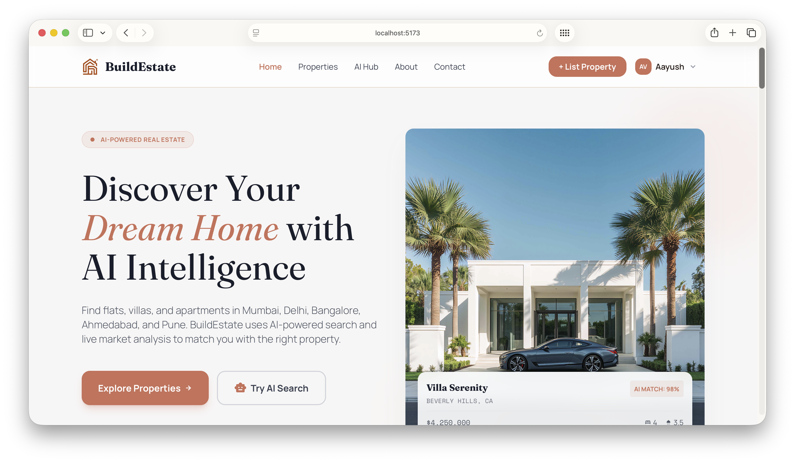

# BuildEstate

An open-source real estate platform for browsing and submitting properties, arranging viewings, and exploring AI-assisted property search in India.

[Public website](https://buildestate.vercel.app) · [Admin sign-in](https://adminnew-seven.vercel.app) · [Contributing](CONTRIBUTING.md) · [License](LICENSE)



## What you can do

- Browse listings, filter properties, view photos and request a viewing.
- Register, manage an account and submit a listing for administrator review.
- Discover external listings with a user-supplied Firecrawl key and server-side NVIDIA model analysis. Availability depends on configured services and tested models; AI output is not verified investment advice.
- Manage properties, reviews, users, appointments, inquiries, subscribers and activity from the desktop admin.
- Configure NVIDIA models through disabled-first catalog management, application testing and explicit activation.

## Repository layout

| Directory | Purpose | Local port |
| --- | --- | --- |
| `frontend/` | Public React/TypeScript website | 5173 |
| `admin/` | React 19/TypeScript desktop administration app | 5175 |
| `backend/` | Express API and Mongoose domain services | 4000 |
| `shared/contracts/` | Shared validators and types | — |
| `backend/docs/` | API contracts, configuration and release notes | — |

The accepted administration app was previously developed as `admin_new/`. It now lives only in `admin/`; the legacy JavaScript admin remains available in Git history. Historical phase and audit documents describe the development process, not additional apps to run.

## Run locally

Use Node.js 22.12+ and npm. MongoDB must support transactions: use Atlas or a local replica set. There is no root package installation; install dependencies from each application directory. Keep the repository layout intact because the apps use `shared/contracts` as a local dependency.

1. Clone the repository.

   ```sh
   git clone https://github.com/AAYUSH412/Real-Estate-Website.git
   cd Real-Estate-Website
   ```

2. Copy `backend/.env.example` to `backend/.env.local`, `frontend/.env.example` to `frontend/.env.local`, and `admin/.env.example` to `admin/.env.local`.
3. Set your database URL, JWT secret and administrator credentials in the backend environment. Configure ImageKit for uploads, Brevo with a verified sender for transactional email, and NVIDIA for AI inference. Users supply their Firecrawl discovery key. Never put backend credentials in client `VITE_*` variables.
4. In three terminals, run:

   ```sh
   cd backend
   npm ci
   npm run dev
   ```

   ```sh
   cd frontend
   npm ci
   npm run dev
   ```

   ```sh
   cd admin
   npm ci
   npm run dev
   ```

Open the website at http://localhost:5173 and admin at http://localhost:5175. Use your own configured administrator credentials; the hosted admin is not a public demo account.

For local admin development, leave `VITE_API_URL` empty: Vite proxies `/api` to `DEV_API_TARGET`, defaulting to http://localhost:4000. The public frontend uses `VITE_API_BASE_URL`. See [admin setup](admin/README.md) and [local email configuration](backend/docs/local-email-configuration.md).

## Architecture

The public website and desktop admin call the Express API. Shared contracts validate inputs; MongoDB transactions coordinate domain changes and audit history. ImageKit stores listing photos. Brevo handles transactional email on a best-effort basis. NVIDIA is the inference provider; Firecrawl discovers external property information.

Admin access tokens stay in memory, with an httpOnly refresh cookie for session restoration. Versioned commands reject stale updates. Listings and accounts are archived rather than permanently purged through the panel; subscriber management permits suppression, not consent grants.

[Admin API contracts](backend/docs/admin-api-contracts.md) · [NVIDIA lifecycle](backend/docs/admin-phase2-nvidia.md) · [Admin acceptance](admin/PHASE_7_ACCEPTANCE.md)

## Verification

Run `npm test` in `backend/`, `frontend/` and `admin/`. Run `npm run build` in both clients and `npm run lint` in `admin/`. Backend tests use an isolated temporary replica set and mocked providers. Browser verification is manual; desktop is the supported admin scope.

## Deployment

The public website and admin are hosted on Vercel; the API is hosted on Azure App Service. [Deployment guide](docs/DEPLOYMENT.md) covers roots, public API configuration, CORS, cookies and rollout verification.

For the folder rename, update the existing admin Vercel project's root from `admin_new` to `admin` before deploying this revision. Its project name and domain do not need to change. Merges affecting backend files on `main` trigger the Azure deployment workflow.

## Contributing

Please read [CONTRIBUTING.md](CONTRIBUTING.md), [CODE_OF_CONDUCT.md](CODE_OF_CONDUCT.md) and [SECURITY.md](SECURITY.md). Open an issue describing the problem or proposed change before large contributions. Do not commit credentials, private database exports or real user data.

Created by [Aayush Vaghela](https://github.com/AAYUSH412). Licensed under the [MIT license](LICENSE).
