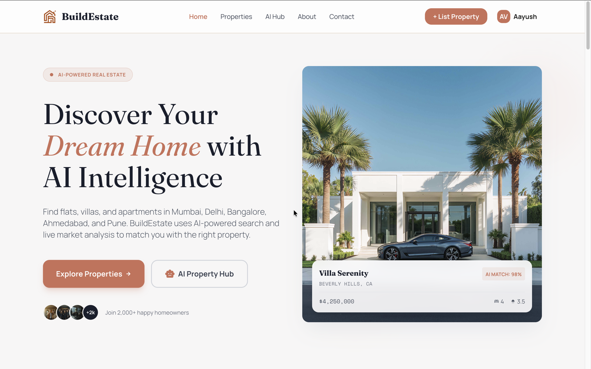
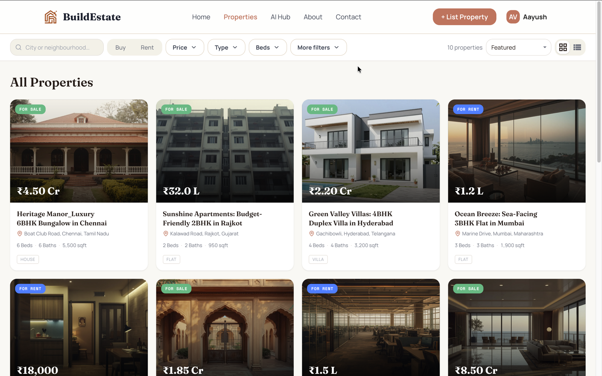
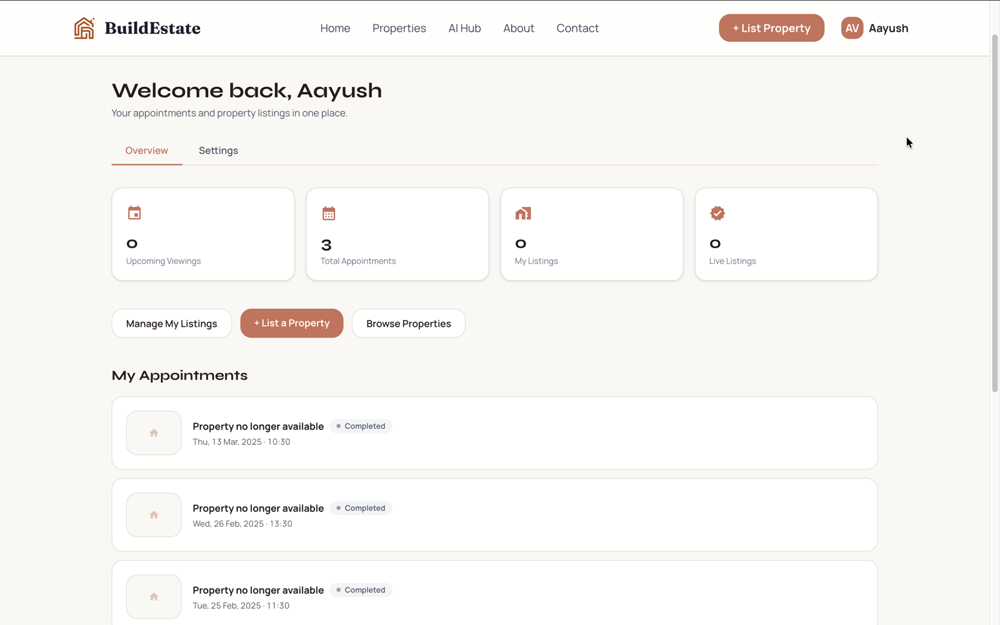
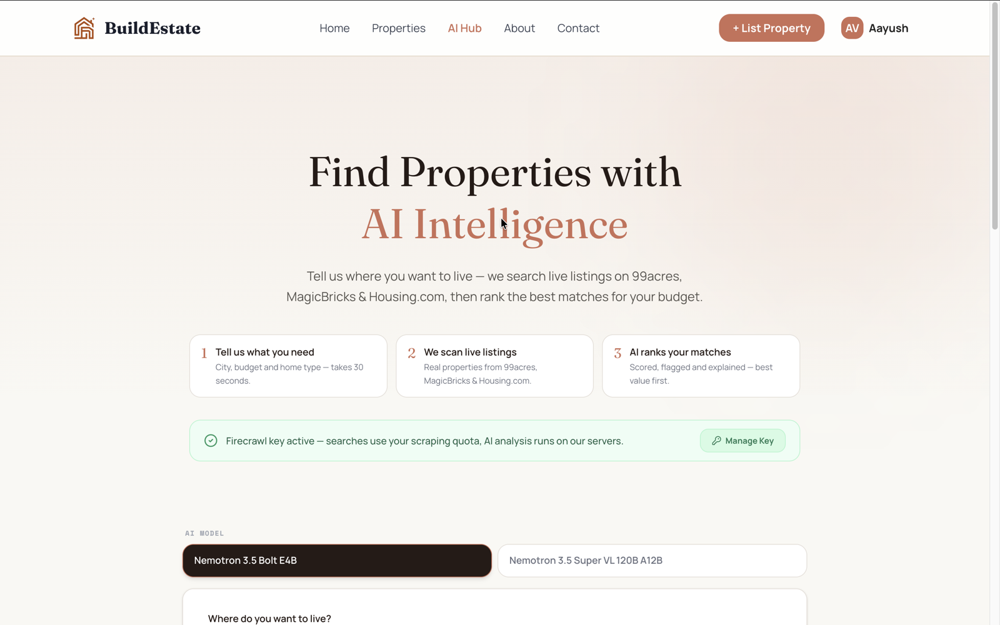
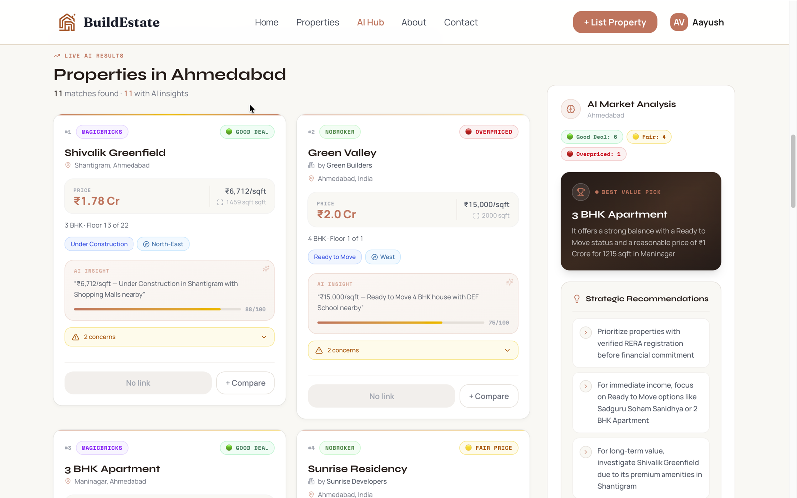
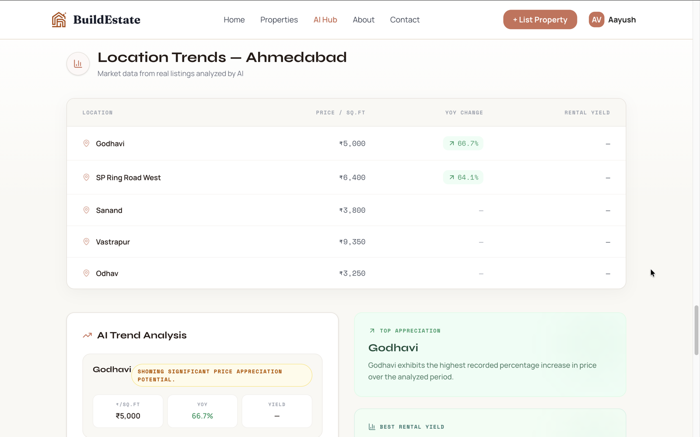
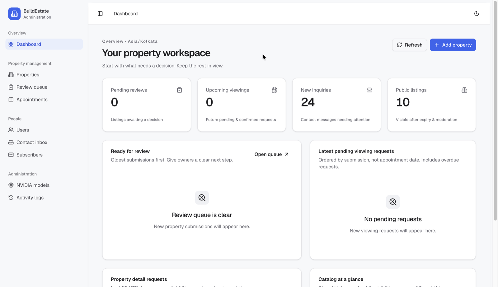
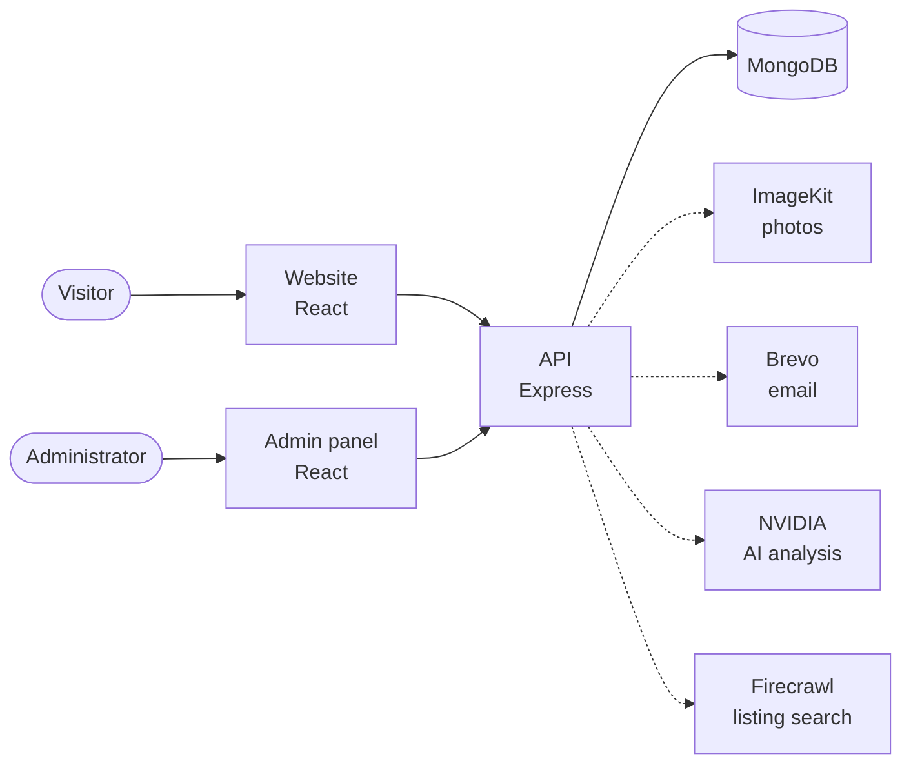

<div align="center">

# BuildEstate

### Open-source AI real estate website with a full admin panel

Built with the MERN stack and TypeScript: React, Node.js, Express and MongoDB.
A complete property listing platform you can run on your own computer in about 5 minutes, with no accounts needed.

[](https://github.com/AAYUSH412/Real-Estate-Website/actions/workflows/verify.yml)
[](LICENSE)
[](https://nodejs.org)
[](https://github.com/AAYUSH412/Real-Estate-Website/stargazers)

**[Live website](https://buildestate.vercel.app)** · **[Quick start](#quick-start)** · **[Screenshots](#screenshots)** · **[Setup guide](docs/SETUP.md)** · **[Help with errors](docs/TROUBLESHOOTING.md)**



</div>

## What is BuildEstate?

BuildEstate is a real estate web application for the Indian property market. People can browse homes, book viewings and submit their own listings. Administrators review those listings and manage the whole site from a separate dashboard. An AI search finds live listings from property portals and ranks them for the buyer's budget.

It has three parts that work together:

| Part | What it is | Runs at |
| --- | --- | --- |
| **Website** (`frontend/`) | The public site visitors use | http://localhost:5173 |
| **Admin panel** (`admin/`) | The dashboard for managing everything | http://localhost:5175 |
| **API** (`backend/`) | The server that stores data and handles the rules | http://localhost:4000 |

## Who is this for?

- **Students** looking for a full stack or final year project to study and extend.
- **Developers** learning how a real MERN application handles login, data safety, testing and deployment.
- **Anyone** building a property listing website who wants a working starting point.

If this project helps you, please give it a star. It helps other people find it.

## Features

### Website

- Browse properties with filters for price, type, bedrooms and buy or rent
- Property pages with photos, amenities and viewing requests, for guests and signed-in users
- Sign up, email verification and password reset
- Personal dashboard for appointments and listings
- Submit your own property for administrator review
- Search engine setup: structured data, sitemap and per-page titles

### Admin panel

- Dashboard with pending work and catalog numbers
- Create, edit and archive properties, with photo uploads
- Review queue to approve or reject user listings
- Manage users, appointments, contact messages and newsletter subscribers
- Activity log of administrator actions, with CSV export
- Light and dark themes (desktop screens only)

### AI Property Hub

- Finds live listings through Firecrawl from 99acres, MagicBricks, Housing.com and NoBroker
- Uses NVIDIA-hosted AI models to score each listing and flag concerns
- Shows market analysis and price trends by locality
- Administrators add, test and activate the AI models from the admin panel

AI output can be wrong, so treat it as a starting point and not as investment advice. To protect API credits, a public deployment can leave this feature off and show an explanation page instead. Run the project locally for the full search.

## Screenshots

| Property search | User dashboard |
| --- | --- |
|  |  |

| AI Property Hub | AI search results |
| --- | --- |
|  |  |

| Location trends | Admin dashboard |
| --- | --- |
|  |  |

## Quick start

You only need **[Node.js 22.12 or newer](https://nodejs.org)** and **[Git](https://git-scm.com/downloads)**. No database install and no accounts. These commands work on Windows, macOS and Linux.

```sh
git clone https://github.com/AAYUSH412/Real-Estate-Website.git
cd Real-Estate-Website
npm run setup
npm run seed
npm run dev
```

What each command does:

1. `npm run setup` installs all three apps and creates your settings files.
2. `npm run seed` starts a local database and adds 7 sample listings, a demo user and an admin account. The first run downloads MongoDB (about 80 MB).
3. `npm run dev` starts everything in one terminal. Press `Ctrl+C` to stop.

Now open:

- **Website:** http://localhost:5173
- **Admin panel:** http://localhost:5175

### Sign in

| Account | Email | Password |
| --- | --- | --- |
| Demo user (website) | `demo@example.com` | `Demo12345!` |
| Admin (admin panel) | `admin@example.com` | The `ADMIN_PASSWORD` value in `backend/.env.local` |

These accounts exist only on your computer. They do not work on the live website.

### Check that it works

1. The website shows 7 sample listings on the Properties page.
2. You can sign in as the demo user.
3. You can sign in to the admin panel and see the dashboard.

Something wrong? Run `npm run doctor`. It tells you what is missing. Then see [Troubleshooting](docs/TROUBLESHOOTING.md).

## What works without any accounts

Everything except the three features below works straight away. Each one has a free option and is turned on by adding keys to `backend/.env.local`, then restarting.

| Feature | Service | Without it |
| --- | --- | --- |
| Uploading new photos | [ImageKit](https://imagekit.io) | Uploads show a clear error. Sample listings still show photos. |
| Sending real emails | [Brevo](https://www.brevo.com) | Verification and password reset links print in the terminal. |
| AI search | [NVIDIA](https://build.nvidia.com) and [Firecrawl](https://www.firecrawl.dev) | AI search stays unavailable. |

Step-by-step instructions, including using MongoDB Atlas instead of the local database, are in the [setup guide](docs/SETUP.md).

## Tech stack

| Area | Technology |
| --- | --- |
| **Website** | React 18, TypeScript, Vite 6, Tailwind CSS 4, React Router 7, Framer Motion |
| **Admin panel** | React 19, TypeScript, Vite 7, shadcn/ui, TanStack Query and Table, React Hook Form |
| **API** | Node.js 22, Express 4, Mongoose 8, JWT, bcrypt, Helmet, rate limiting |
| **Database** | MongoDB (replica set, because the app uses transactions) |
| **Services** | ImageKit (photos), Brevo (email), NVIDIA NIM (AI), Firecrawl (listing search) |
| **Testing and delivery** | Node test runner, Vitest, GitHub Actions, Docker, Vercel, Azure App Service |

## How it works



Solid lines are required. Dotted lines are optional services. Read the [architecture guide](docs/ARCHITECTURE.md) to see how each part works.

## What you can learn from this code

This project goes beyond basic CRUD, so it is useful to study:

| Topic | Where to look |
| --- | --- |
| Login with short-lived tokens and httpOnly refresh cookies | `admin/src/lib/api.ts`, `backend/controller/userController.js` |
| MongoDB transactions and audit logs | `backend/services/` |
| Stopping two admins overwriting each other (versioned updates) | `backend/services/listingService.js` |
| One set of validation rules shared by all apps | `shared/contracts/` |
| Streaming AI progress to the browser (Server-Sent Events) | `backend/services/`, `frontend/src/components/ai-hub/` |
| Isolated API tests with a temporary database | `backend/tests/` |
| Automatic testing and deployment | `.github/workflows/` |

## Project structure

```text
Real-Estate-Website/
├── frontend/          Public website (React + TypeScript)
│   ├── src/pages/       One file per page
│   ├── src/components/  Page sections and shared UI
│   └── src/services/    Calls to the API
├── admin/             Admin panel (React + TypeScript)
│   ├── src/features/    One folder per admin section
│   └── src/components/  Tables, forms and shared UI
├── backend/           API (Express + Mongoose)
│   ├── routes/          URLs
│   ├── controller/      Request handling
│   ├── services/        Business rules, AI and email
│   ├── models/          Database structure
│   ├── middleware/      Login checks, validation and rate limits
│   ├── scripts/         Seed data and maintenance tools
│   └── tests/           API tests
├── shared/contracts/  Validation rules used by every app
├── scripts/           The root npm commands
├── docs/              Guides
└── Images/            README screenshots
```

## Commands

Run these from the repository root.

| Command | What it does |
| --- | --- |
| `npm run setup` | Installs everything and creates missing settings files. Never overwrites existing ones. |
| `npm run seed` | Adds sample data to an empty database. Refuses production and remote databases. |
| `npm run dev` | Starts the database, API, website and admin panel. |
| `npm run doctor` | Explains what is missing, without printing secrets. |
| `npm run smoke` | Starts the API and checks that the main flows work. |
| `npm test` | Runs all automated tests. |
| `npm run build` | Builds the website and admin panel. |
| `npm run check:docs` | Checks that links in the documentation work. |

## Testing

There are 135 automated tests: 94 for the API, 9 for the website and 32 for the admin panel. API tests create their own temporary database and never call real services. Every pull request also runs this README's quick start on Windows, macOS and Linux, so a broken setup is caught early.

## Deployment

The live project runs the website and admin panel on Vercel, and the API on Azure App Service using Docker. Merging API changes into `main` deploys them automatically. See the [deployment guide](docs/DEPLOYMENT.md) to host your own copy.

## Known limitations

Good places to start contributing:

- The admin panel supports desktop screens only.
- Email is best-effort, with no retry queue if sending fails.
- Browser testing is manual, with no automated end-to-end tests yet.
- AI search results depend on third-party sites and can change without notice.

## Frequently asked questions

**Can I use this for my college or final year project?**
Yes. The [MIT license](LICENSE) allows personal, academic and commercial use. Keep the license notice, and make sure you understand the code you present.

**Do I need to pay for anything?**
No. Running locally is free. ImageKit, Brevo, NVIDIA and Firecrawl are optional and offered free options when this guide was written. Check each site for current limits.

**Why not plain `mongod`?**
The app uses MongoDB transactions, which need a replica set. `npm run dev` starts one for you, or you can use a free MongoDB Atlas cluster.

**Is there a public admin demo?**
No, because the hosted admin panel manages real data. Run it locally to try every feature.

**Where do I report a security problem?**
Please follow [SECURITY.md](SECURITY.md) instead of opening a public issue.

## Documentation

- [Setup guide](docs/SETUP.md): every step in detail, including optional services
- [Troubleshooting](docs/TROUBLESHOOTING.md): common errors and fixes
- [Architecture](docs/ARCHITECTURE.md): how the system fits together
- [API reference](docs/API.md): all endpoints
- [Deployment](docs/DEPLOYMENT.md): hosting your own copy
- App guides: [website](frontend/README.md), [admin panel](admin/README.md), [API](backend/README.md)
- [Project history](docs/history/README.md): earlier audits and release notes

## Contributing

Contributions of all sizes are welcome, especially from first-time contributors. Read the [contributing guide](CONTRIBUTING.md) and look for issues labelled [good first issue](https://github.com/AAYUSH412/Real-Estate-Website/labels/good%20first%20issue).

## License

[MIT](LICENSE). Created by [Aayush Vaghela](https://github.com/AAYUSH412).
