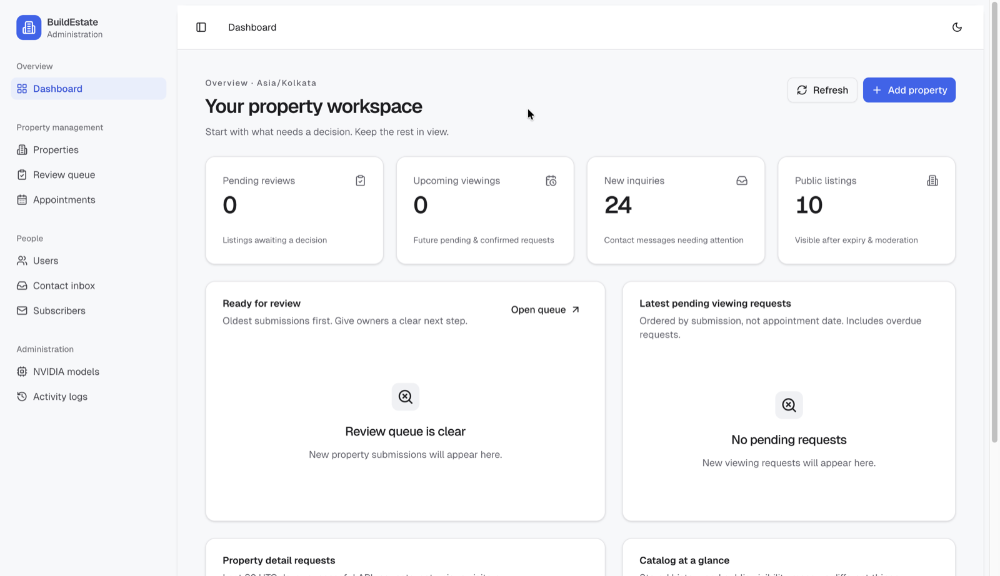

# BuildEstate admin panel

The desktop dashboard for running [BuildEstate](../README.md): listings, reviews, users, appointments, messages, subscribers, AI models and activity logs.



## Run it

The easiest way is from the repository root, which starts everything:

```sh
npm run setup
npm run seed
npm run dev
```

Open http://localhost:5175 and sign in with `ADMIN_EMAIL` and `ADMIN_PASSWORD` from `backend/.env.local`.

To run only this app, with the API already running on port 4000:

```sh
cd admin
npm ci
npm run dev
```

This panel supports desktop screens only. There is no public demo account for the hosted version.

## Settings

`admin/.env.local`:

| Variable | Purpose |
| --- | --- |
| `VITE_API_URL` | Leave empty locally. When hosting, set the API's HTTPS address without `/api`. |
| `DEV_API_TARGET` | Where the local proxy sends `/api`. Defaults to `http://localhost:4000`. |

Locally, the browser talks to the panel's own address, and Vite forwards `/api` to the API. The proxy removes the browser's `Origin` header on the way, so local requests skip the API's CORS check. There is no proxy in production: the panel's address must be allowed through `ADMIN_URL` or `EXTRA_ALLOWED_ORIGINS` on the API.

## Tech stack

React 19, TypeScript, Vite 7, Tailwind CSS 4, shadcn/ui (Radix), TanStack Query and Table, React Hook Form and Recharts.

## Screens

| Screen | Address | What you can do |
| --- | --- | --- |
| Dashboard | `/dashboard` | See pending work and catalog numbers |
| Properties | `/properties` | Search, create, edit and archive listings |
| Review queue | `/reviews` | Approve or reject user listings |
| Appointments | `/appointments` | Manage viewing requests |
| Users | `/users` | View, suspend, ban and restore accounts |
| Contact inbox | `/leads` | Handle contact messages |
| Subscribers | `/subscribers` | Suppress newsletter subscribers |
| NVIDIA models | `/ai-models` | Add, test and activate AI models |
| Activity logs | `/activity` | Review and export administrator actions |

## How sessions work

The access token stays in memory and is never stored in `localStorage`. An httpOnly cookie restores the session after a reload.

- Refresh calls are shared within a tab and coordinated across tabs with Web Locks where the browser supports it.
- Signing out or switching accounts clears cached private data.
- Temporary failures keep you signed in and offer a retry. A 401 or 403 from the API returns you to sign in.

Browser storage keeps only conveniences such as the theme.

## Patterns to follow in the code

| Where | What it does |
| --- | --- |
| `src/lib/api.ts` | Sends credentials, handles errors, runs one refresh at a time and supports cancelling |
| `src/app/query-client.ts` | Query keys, careful retries and no automatic retry of changes |
| `src/components/data-table/data-table.tsx` | Server-side paging and sorting. Screens reset selection when the page or filters change. |
| `src/components/feedback/` | Loading, error and empty states, status labels and confirmations |

New changes to data must send the version they displayed, show field errors, and refresh affected queries after saving.

## Status colors

All status pills use `StateBadge` in `src/components/feedback/status-badge.tsx`. Keep the meanings consistent:

| Color | Meaning | Examples |
| --- | --- | --- |
| Amber | Needs attention | Pending, new, unverified |
| Blue | Underway | Confirmed, in progress |
| Green | Successful or available | Published, completed, verified, resolved |
| Red | Stopped | Cancelled, rejected, banned |
| Purple | Temporarily restricted | Suspended |
| Gray | Inactive or history | Archived, expired, disabled, unsubscribed |

Every status also has a label, so color is never the only cue.

## Commands

| Command | What it does |
| --- | --- |
| `npm run dev` | Starts the development server on port 5175 |
| `npm test` | Runs the 32 tests with Vitest |
| `npm run lint` | Checks code style |
| `npm run build` | Checks types and builds for production |
| `npm run preview` | Serves the production build on port 4175 |

Browser testing is manual. Automated tests cover sessions, property and photo handling, and management commands. They use mocked requests and do not use NVIDIA quota.

## Deployment

See the [deployment guide](../docs/DEPLOYMENT.md). Set the Vercel Root Directory to `admin`, allow access to files outside the root for `shared/contracts`, and set `VITE_API_URL`.
