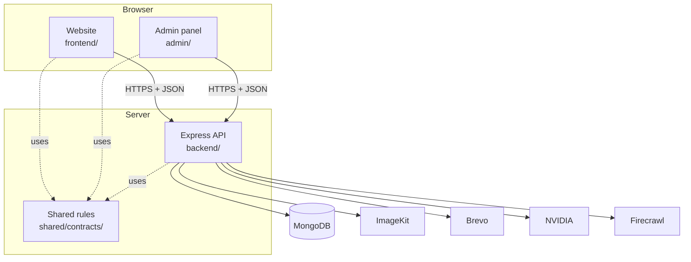
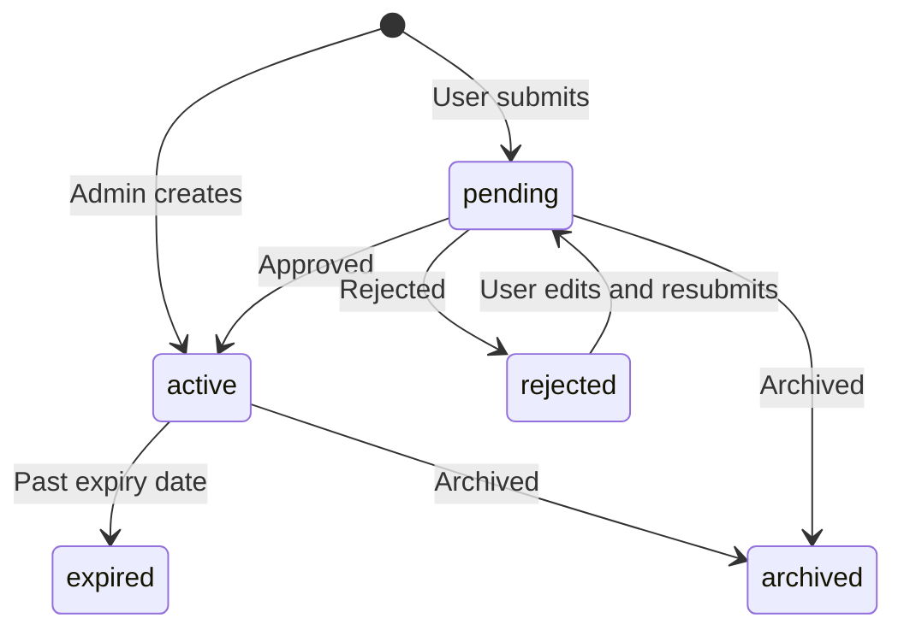
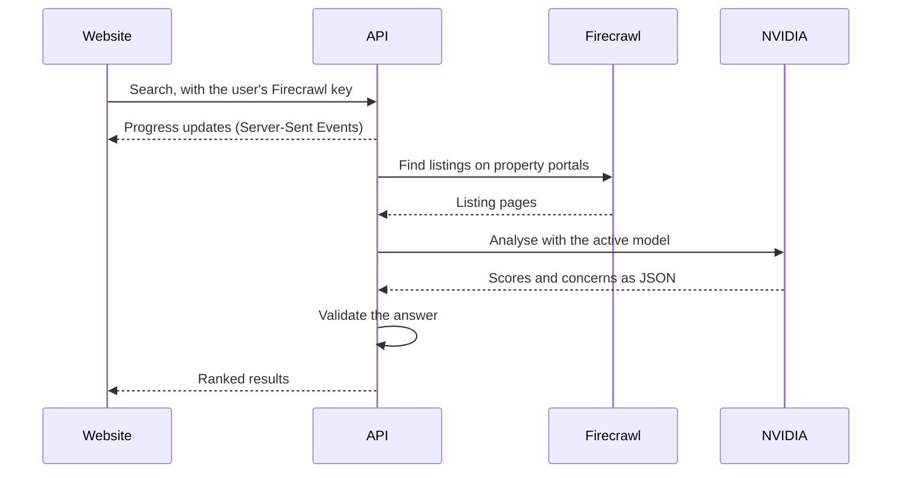
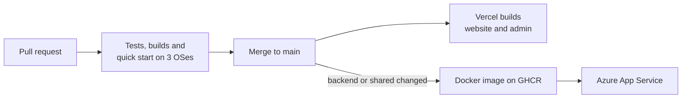

# Architecture

How BuildEstate fits together, written so you can find your way around the code.

## The big picture

The browser apps never talk to the database or hold server keys. Everything goes through the API.

## How a request travels through the API

Example: an administrator approves a listing.

1. **`routes/`** matches the URL to a handler.
2. **`middleware/`** checks the login, validates input and applies rate limits.
3. **`controller/`** reads the request and calls the right rule.
4. **`services/`** applies the business rules inside a database transaction.
5. **`models/`** defines the data saved to MongoDB.
6. The response goes back as JSON. Any email goes out after the data is safely saved.

## Shared contracts

`shared/contracts/` holds validation rules and types used by all three apps. A rule such as "a listing has 1 to 4 photos" lives in one place, so the browser and the API cannot disagree. Each app installs it as a local package, which is why the folder layout must stay the same.

## Login and sessions

| | Website users | Administrators |
| --- | --- | --- |
| Login route | `POST /api/users/login` | `POST /api/users/admin` |
| Refresh route | `POST /api/users/refresh` | `POST /api/users/admin/refresh` |

The admin panel keeps its short-lived access token **in memory only**, never in `localStorage`, where a malicious script could read it. A separate refresh token lives in an **httpOnly cookie**, which JavaScript cannot read. When the page reloads, the panel uses that cookie to get a new access token.

The API also enforces account status: suspended and banned users lose access.

## Keeping data safe

- **Transactions.** Related changes are saved together or not at all. This is why MongoDB must be a replica set.
- **Versioned updates.** Each record has a version number. If two administrators edit the same listing, the second save is rejected with a conflict instead of silently overwriting the first.
- **Audit log.** Administrator actions are recorded and visible under **Activity logs**.
- **Archiving.** Listings and accounts are archived from the panel rather than permanently erased.
- **Subscriber consent.** Administrators can suppress a newsletter subscriber, but cannot grant consent on someone's behalf.

## Listing lifecycle

## Photo uploads

1. The API holds the uploaded file in memory (up to 4 photos, 5 MB each).
2. [Sharp](https://sharp.pixelplumbing.com/) checks that it is a real, safe image.
3. The API uploads it to ImageKit using its private key.
4. The photo address is saved in MongoDB inside a transaction.
5. If saving fails, the newly uploaded photos are removed.

## AI Property Hub

- **Firecrawl keys** belong to each user and are sent with their request.
- **The NVIDIA key** stays on the server.
- **Models** start disabled. An administrator must pass an application test before enabling one, and the API falls back to the next tested model if one fails.

See the [NVIDIA model guide](../backend/docs/admin-phase2-nvidia.md).

## Email

Brevo sends transactional email through its REST API. Sending happens after data is saved and is best-effort, so a failed email never undoes a saved change. There is no retry queue. In local development without a key, account links print in the terminal instead.

## Delivery

## Where to find things

| I want to change... | Look in |
| --- | --- |
| A website page | `frontend/src/pages/` |
| An admin screen | `admin/src/features/` |
| An API address | `backend/routes/` |
| A business rule | `backend/services/` |
| What data is stored | `backend/models/` |
| A validation rule | `shared/contracts/index.js` |
| An email design | `backend/email.js` |
| The AI prompts and models | `backend/services/`, `backend/services/llm/` |
