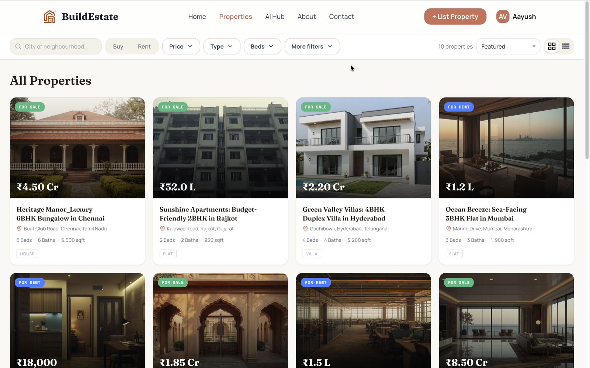

# BuildEstate website

The public website of [BuildEstate](../README.md), where visitors browse properties, book viewings, submit listings and use AI search.



## Run it

The easiest way is from the repository root, which starts everything:

```sh
npm run setup
npm run seed
npm run dev
```

The website opens at http://localhost:5173. To run only this app, with the API already running:

```sh
cd frontend
npm ci
npm run dev
```

## Settings

`frontend/.env.local`:

| Variable | Purpose |
| --- | --- |
| `VITE_API_BASE_URL` | API address without `/api`. Locally: `http://localhost:4000`. |
| `VITE_ENABLE_AI_HUB` | `true` shows the full AI Hub. When unset, `/ai-hub` shows an explanation page. |

These values are public and built into the browser code. Never put secrets in them.

## Tech stack

React 18, TypeScript, Vite 6, Tailwind CSS 4, React Router 7, Axios, Framer Motion, Radix UI and Lucide icons.

## Pages

| Page | Address | Login |
| --- | --- | --- |
| Home | `/` | |
| Properties | `/properties` | |
| Property details | `/property/:id` | |
| AI Hub | `/ai-hub` | |
| About | `/about` | |
| Contact | `/contact` | |
| Sign in | `/signin` | |
| Sign up | `/signup` | |
| Forgot password | `/forgot-password` | |
| Reset password | `/reset/:token` | |
| Verify email | `/verify-email/:token` | |
| Newsletter | `/newsletter/confirm`, `/unsubscribe` | |
| Privacy and terms | `/privacy`, `/terms` | |
| Dashboard | `/dashboard` | Required |
| My listings | `/my-listings` | Required |
| Add a property | `/add-property` | Required |
| Edit a property | `/edit-property/:id` | Required |

## Folder guide

```text
frontend/
├── api/              Vercel function for the sitemap
├── public/           Logos, icons, robots.txt and demo listing photos
├── src/
│   ├── components/   Sections for each page, plus shared UI in common/ and ui/
│   ├── contexts/     Signed-in user state
│   ├── hooks/        Reusable React logic
│   ├── pages/        One file per page, loaded when needed
│   ├── services/     api.ts, all calls to the API
│   ├── images/       Photos used by page designs
│   └── styles/       Global CSS and Tailwind setup
└── tests/            Automated tests
```

## Commands

| Command | What it does |
| --- | --- |
| `npm run dev` | Starts the development server |
| `npm test` | Runs the tests |
| `npm run typecheck` | Checks TypeScript types |
| `npm run build` | Checks types and builds for production |
| `npm run preview` | Serves the production build locally |

## Deployment

See the [deployment guide](../docs/DEPLOYMENT.md). The live site is at https://buildestate.vercel.app.
